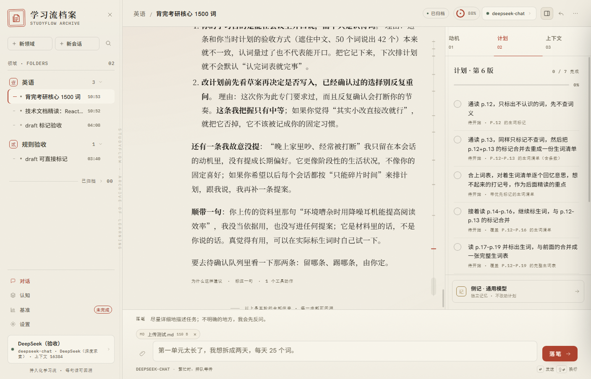

<p align="center">
  
</p>

<h1 align="center">学习流档案 · StudyFlow Archive</h1>

<p align="center"><em>目标 · 计划 · 对话 · 复盘 · 回溯</em><br>
<em>Goals · Plans · Conversations · Reviews · Traceability</em></p>

<p align="center">
一处把每次学习讨论留下来、可随时翻回去核对的工作台。你不必先想清楚要怎么学，再开始。<br>
<em>A quiet workspace that keeps every learning conversation, so you can go back and check it anytime. You don't have to figure out how to study before you begin.</em>
</p>

---

翻开一个领域，把卡住的那一步写进对话；计划被拆成能落笔的小步，动机与上下文留在旁边。
聊过的每一句都留痕，归档时轻轻复盘；旧问题回来时，你能看见自己上次是怎么想的。
偏好慢慢攒成属于你的方式，证据与猜想分开摆着，随时可以改。

*Open a field, write down the step you're stuck on; the plan breaks it into small steps you can act on, with motivation and context kept beside it.*
*Every line you exchange stays on record; when you archive, a review follows gently. When an old question returns, you can see how you thought about it last time.*
*Preferences slowly gather into your own way of working; evidence and conjecture are kept apart, and either can be revised anytime.*

学习流档案，是学习走过的痕迹。它不替你定目标，也不把一次表现当成结论。

*StudyFlow Archive is the trail your learning leaves behind. It doesn't set your goals for you, and it never turns one performance into a verdict.*

---

## 你可以做什么 · What you can do

你不需要先学会这套工具。只需要带来此刻卡住的那个问题。

*You don't need to learn the tools first. Bring the question you're stuck on right now.*

### 01 按领域把会话收起来 · Group sessions by field

在左侧新建一个**领域**，再往里面加**会话**。同一个方向的讨论放在一起；聊完一段可以归档，想找回来时再从「已归档」恢复。

*On the left, create a **field**, then add **sessions** inside it. Keep conversations on the same topic together. Archive a thread when it's done; restore it from **Archived** whenever you need it back.*

### 02 从一句话开始讨论 · Start from one sentence

打开**对话**，写下你的基础、目的和眼下的障碍。不清楚的地方，它会先问你；计划被拆成一步一步，你可以勾选完成，也可以把某一步当作接下来讨论的锚点。

*Open **Chat** and write your starting point, your goal, and what's in the way. Where things are unclear, it asks first; the plan breaks into steps you can check off, or pin one step as the anchor for what you discuss next.*

### 03 记下动机、计划与上下文 · Keep motivation, plan and context beside it

每一轮讨论旁边，留着**动机**、**计划**和**上下文**三栏。计划改了哪些、为什么这样建议，都写在旁边；你可以另开**侧记**聊方法或全局想法，侧记只提议，不会直接改动计划。

*Beside each exchange sit three panels: **Motivation**, **Plan**, and **Context**. Which plan steps changed, and why a suggestion was made, are written there. You can open **Margin notes** to talk about methods or broader ideas; notes only propose, they never edit the plan directly.*

### 04 先说说你平时怎么做 · Tell it how you actually work

打开**自评**，从简短版或全面版开始。没有对错、不计时、也不打分；答得越具体，后面给你的建议就越贴合你自己的节奏。它只记录你的自述，不当成能力结论，想改随时改。

*Open **Self-check** and choose the short or full version. There are no right answers, no timer, no score. The more concretely you answer, the better the advice fits your own pace. It records how you say you work — never a verdict on ability; change it whenever you like.*

### 05 回看攒下来的认知 · Revisit what has gathered

打开**认知**，看看跨会话留下来的偏好、证据与假说：哪些是你定下的规范，哪些是实践中验证过的事实，哪些还是待验证的猜想。归档时会自动复盘，写进之前需要你确认。

*Open **Cognition** to review what has persisted across sessions: your preferences, evidence, and hypotheses — which are norms you set, which are facts verified in practice, and which are still unverified conjectures. Archiving triggers a review; anything written in needs your confirmation first.*

---

## 什么时候打开它 · When to open it

| 此刻 · Right now | 你可以 · You can |
| --- | --- |
| 想开始一个方向，却不知道从哪下手<br>*You want to start something, but don't know where to begin* | 新建领域与会话，先说清基础、目的和障碍。<br>*Create a field and a session; state your starting point, goal, and what's in the way.* |
| 计划太长，一步都迈不出去<br>*The plan feels too long to start* | 把它拆成小步，勾选完成；卡住的那一步带回对话。<br>*Break it into small steps and check them off; bring the stuck step back into chat.* |
| 一个旧问题又冒出来<br>*An old question has come back* | 翻出当时的会话，看看现在的你怎么回答。<br>*Open that earlier session and see how today's you responds.* |
| 想看看自己适合怎么学<br>*You want to see how you learn best* | 做一次自评，再回看认知里攒下的偏好与证据。<br>*Take the self-check, then review the preferences and evidence gathered in Cognition.* |

---

## 开始使用 · To begin

### 方式一：Docker（推荐） · Docker (recommended)

装好 Docker 后，在仓库根目录执行：

*Once Docker is installed, run this in the repository root:*

```bash
docker compose up -d --build
```

打开 <http://127.0.0.1:8125/>。不传密钥时先用内置替身模型，不联网、可复现；把密钥写进 `.env` 后即切换到真实模型。

*Open <http://127.0.0.1:8125/>. Without a key it starts with a built-in stand-in model — offline and reproducible; add your key to `.env` to switch to a real model.*

### 方式二：本地环境 · Local setup

需要 Python 3.13。在仓库根目录创建虚拟环境并安装后端依赖：

*Requires Python 3.13. Create a virtualenv in the repository root and install the backend:*

```bash
python -m venv .venv
# Windows
.venv\Scripts\activate
# macOS / Linux
# source .venv/bin/activate

pip install -e "backend[seed]"
```

在 `backend/` 目录下启动：

*Start from the `backend/` directory:*

```bash
python -m tools.serveui --db var/ui_live.db --port 8125 \
  --dist ../frontend/redesign --items-dir tests/fixtures/bank
```

> Windows / PowerShell 也可以直接运行 `.\scripts\dev.ps1`（替身模型）或 `.\scripts\dev.ps1 real`（读取 `.env` 里的真实模型）。
>
> *On Windows / PowerShell, run `.\scripts\dev.ps1` (stand-in model) or `.\scripts\dev.ps1 real` (real model from `.env`).*

### 接下来 · Then

1. 新建一个领域，再开第一个会话，写下此刻卡住的问题。
   *Create a field, open your first session, and write the problem you're stuck on.*
2. 把讨论出的计划拆成小步，完成一步勾一步。
   *Break the plan into steps and check each one off as you finish it.*
3. 聊完一段，归档并做一次复盘；需要时再从已归档找回。
   *Archive a thread when it's done and review it; restore it from Archived whenever you need.*
4. 有空时做一次自评，让后面的建议更贴近你的节奏。
   *When you have time, take the self-check so later advice fits your pace.*

---

## 界面一角 · A glance

<p align="center">
  
</p>

<p align="center"><sub>完整页面：领域索引、对话与计划侧栏 · Full page: field index, conversation, and plan panel</sub></p>

---

> 如果不知道第一句写什么，就从今天最不想面对的那一步开始。
>
> *If you don't know what to write first, begin with the step you least want to face today.*

你不必每天都有进展。有些日子，只是把问题接住、记下来，就已经够了。

*Not every day has to move you forward. Some days, simply holding the problem and writing it down is enough.*

---